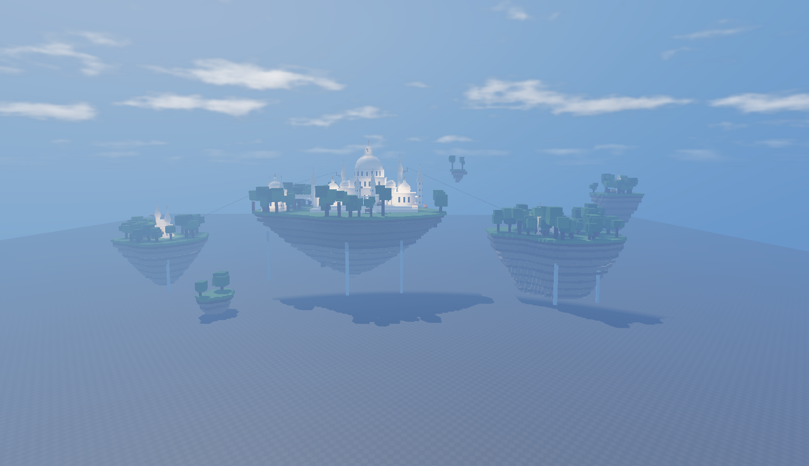
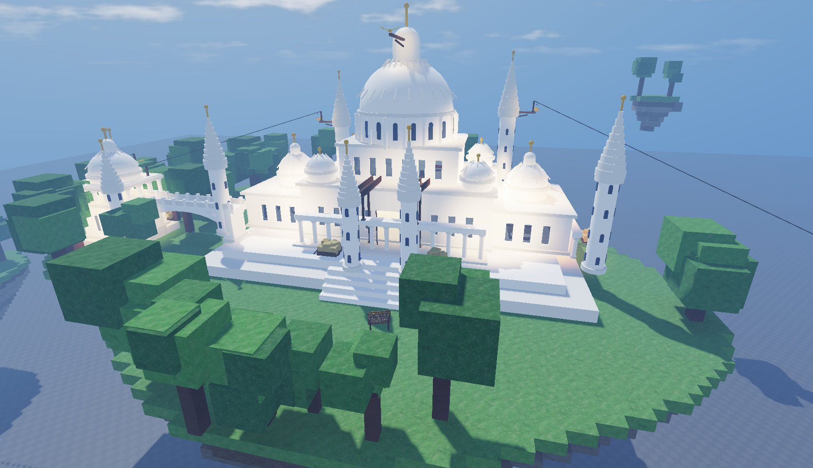
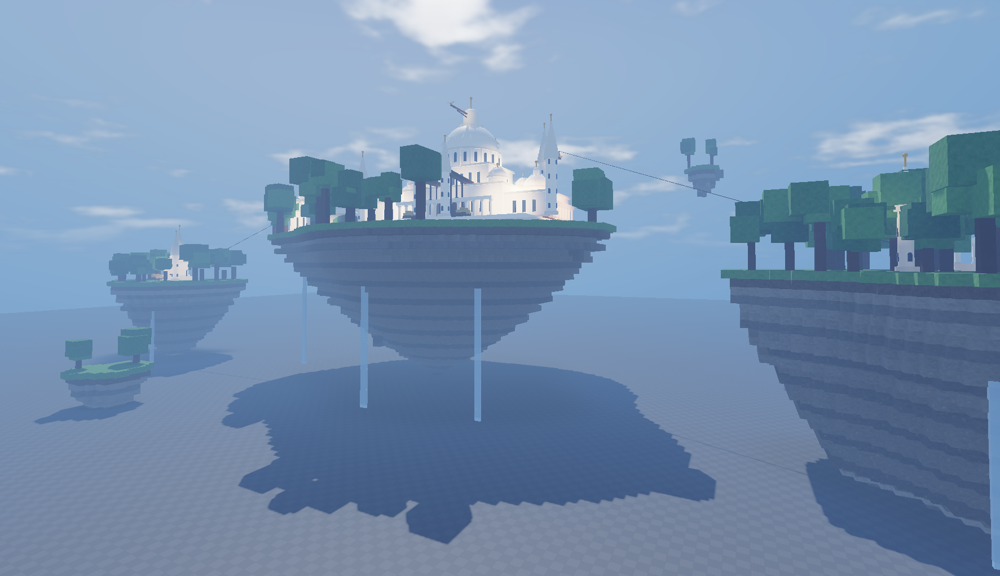

# Floating Sky Palace

A white marble palace on floating islands in Roblox, built entirely by a script. Paste one file into Roblox Studio and it builds the islands, the palace, the trees, the waterfalls, and the sky. A second set of scripts adds Assassin's Creed style free-running, so you can climb the palace, jump between islands, ride ziplines, and take a Leap of Faith into hay.

## What gets built

- A main floating island with grass on top, a tapered rock underside, ragged edges, cliff ledges, and moss.
- A white palace with a great central dome, smaller corner domes, tall spires with gold tips, colonnades, arched windows, and an arch bridge to a pavilion.
- Rooms you can walk into: a throne room, a library, a dining hall, royal chambers, and stairs between them.
- Smaller islands around it, including one with twin towers, plus two tiny drifting islets.
- Blocky trees, bushes, flowers, and long waterfalls falling off the islands.
- A soft blue sky with haze, clouds, bloom, and sun rays.

## Build the palace

1. Open Roblox Studio and open any place. A Baseplate is fine.
2. Open the Command Bar from the View tab.
3. Paste all of `FloatingSkyPalace.lua` into the Command Bar and press Enter.
4. Wait a few seconds. A model named `FloatingSkyPalace` appears in Workspace and the camera moves to a good view.

Running it again deletes the old palace and builds a new one, so you can change the values under `CONFIG` at the top and run it again. Change `SEED` to get a different island shape and tree layout.

## Add parkour

The files in `Parkour` turn the palace into a free-running course. Build the palace first.

1. Paste all of `Parkour/ParkourProps.lua` into the Command Bar and press Enter. It adds hay carts, viewpoint perches with a golden eagle on the tallest spires, ziplines, rooftop beams, and a controls sign at the spawn.
2. In ReplicatedStorage, make a Folder named `Parkour`. Inside it, make a ModuleScript named `ParkourConfig` and paste in `Parkour/ParkourConfig.lua`.
3. In ServerScriptService, make a Script named `ParkourServer` and paste in `Parkour/ParkourServer.lua`.
4. In StarterPlayer, then StarterPlayerScripts, make a LocalScript named `ParkourClient` and paste in `Parkour/ParkourClient.lua`.
5. Press Play.

Everything is climbable unless it can't be collided with or is tagged `NoClimb`. Speeds, jump heights, fall damage, and keys are all in `ParkourConfig`.

### Controls

- Hold Shift to free-run. Run at a wall to climb it, at a low wall to vault it, or jump at a wall at an angle to run along it.
- While climbing, WASD moves along the wall. Push up at a ledge to pull yourself over.
- Space jumps. On a wall, Space with W leaps up, with A or D leaps sideways, and with S or nothing kicks off backwards.
- While falling you catch any wall or ledge you touch.
- Ctrl or C lets go of a wall, drops from a zipline, or drops off an edge so you hang from it.
- E does a Leap of Faith at an edge with hay below, synchronises at a viewpoint, or rides a zipline from its start post.
- Hold Shift when you land from a high fall to roll and take no damage.

Each viewpoint you synchronise adds one to your Viewpoints count on the leaderboard.

## Changes

Newest first. Each new change goes at the top of this list.

### 15 October 2026

- The palace, its islands, and the parkour scripts are on GitHub with screenshots of the castle.
